# 灯影 · 一盏灯照见千年

> 中国皮影戏数字展馆 ｜ 2026「零杯」网页设计大赛参赛作品 ｜ 参赛主题：**非遗**

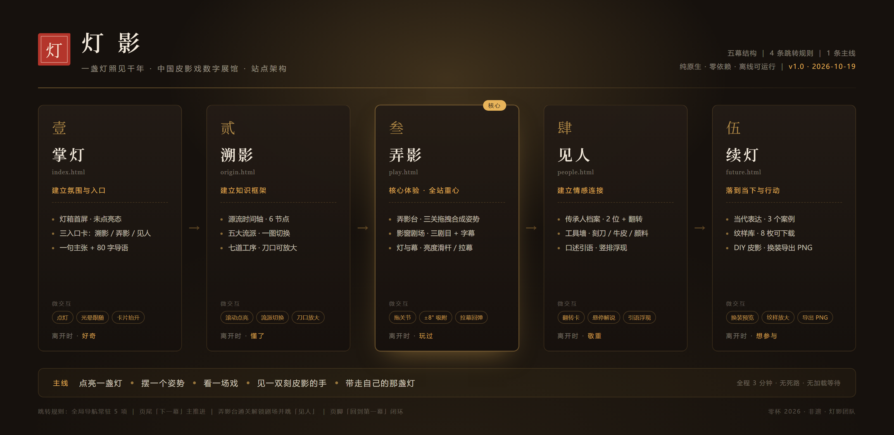

**灯影**是一个可以"点灯、弄影、看戏"的皮影戏数字展馆。它不陈列文物，而是把一座灯箱戏台搬进浏览器：你先点亮一盏灯，再亲手拖动皮影的关节摆出亮相、开弓、跨马的姿势，通关后走进影窗剧场看一出戏，最后见到刻皮影的人，点亮自己的一盏灯。

全站 **5 个页面**，**纯原生 HTML / CSS / JavaScript**，零第三方库、零外部资源、断网可运行，适配 390–1920px 全尺寸。

> **界面规格声明**：本作品采用 **1920px** 界面规格，同时向下自适应 **1440 / 720** 与移动端（390px 起）。同一句声明已写在全站五页页脚，评委不必翻 README 也能看到。

> **队名** 灯下黑 ｜ **组别** 壹组 ｜ **队长** 闫煦 ｜ **参赛主题** 非遗 · 中国皮影戏

---

## 一、为什么做这个站

皮影戏有一句话：**"一口叙说千古事，双手对舞百万兵。"**

它曾经是村落里最热闹的夜晚，如今却常常只出现在博物馆的玻璃柜里——隔着一层玻璃，看得见牛皮上的刀口，却看不见光穿过它的样子。

我们想做的，不是把皮影戏"介绍"给用户，而是让用户在 3 分钟里**亲手演一次**。因为理解一门手艺最快的方式，从来不是读说明，而是上手。

## 二、快速开始

不需要安装任何依赖，也不需要启动服务器。

| 方式 | 操作 |
| --- | --- |
| 单文件版（推荐评审使用） | 解压 `灯影_单文件版.zip`，双击 `index.html` |
| 工程版（查看源码） | 解压 `灯影_工程版.zip`，双击 `index.html` |
| 仓库直接预览 | 双击仓库里的 `web/index.html` |

> 推荐浏览器：**Chrome 129**（评测环境）。已在 **Chrome 129.0.6668.100**（Chrome for Testing）与 Edge 155 下逐页实测：30 组审计 0 报错、0 第三方请求、0 横向溢出；只使用 Chrome 100+ 已稳定的 API，没有实验特性。

## 三、亮点功能

1. **点灯开场**：首屏是暗的。只有一盏没点燃的灯和一句"灯亮起来，皮影才活"。点击之后，整站亮起，皮影从幕布后浮出——把"进入网站"变成"点亮一盏灯"。
2. **弄影台（核心交互）**：三关拖拽，1 分钟内可通关。4 个可操作关节、±8° 吸附、金色光环反馈、反向阻尼手感；通关后印章落下，解锁剧场。键盘也能玩：`Tab` 选中关节，`←/→` 微调，`Shift` 加速。
3. **影窗剧场**：三出经典剧目片段，字幕逐字浮现，灯箱亮度可调（30%–100%）；暗下来时字幕自动加亮，保持可读。
4. **七道工序**：选皮、制皮、画稿、镂刻、敷彩、发汗熨平、缀结——点开"镂刻"能看到刀口细节，用细节证明"我们真的查过"。
5. **可带走**：纹样库 8 枚可下载 SVG；DIY 皮影可换头型、换纹样、换配色，并导出 PNG。
6. **真的零依赖**：没有 Bootstrap、没有 Element、没有 CDN、没有外链字体。全部图形是手写 SVG，断网也能完整浏览。

## 四、页面导览

| 幕次 | 页面 | 文件 | 一句话 |
| --- | --- | --- | --- |
| 壹 · 掌灯 | 首页 | `index.html` | 建立氛围与入口，点亮整座灯箱 |
| 贰 · 溯影 | 源流 | `origin.html` | 时间轴、五大流派、七道工序 |
| 叁 · 弄影 | 体验 | `play.html` | 弄影台三关 + 影窗剧场 |
| 肆 · 见人 | 传承 | `people.html` | 传承人、工具墙、口述引语 |
| 伍 · 续灯 | 当下 | `future.html` | 当代表达、纹样库、DIY 皮影 |

主线：**掌灯 → 溯影 → 弄影 → 见人 → 续灯**，五幕连成一条 3 分钟的动线。

## 五、技术说明

| 项 | 说明 |
| --- | --- |
| 语言 | HTML5 / CSS3 / 原生 JavaScript（ES2019+，无框架） |
| 图形 | 全站手写内联 SVG；皮影由"关节骨架 + 剪影轮廓"构成 |
| 交互 | Pointer Events 拖拽 + 角度吸附；滚动驱动（IntersectionObserver）；`localStorage` 记忆点亮与通关状态 |
| 布局 | CSS Grid + `clamp()` 流式排版；三档断点（≥1440 / 721–1439 / ≤720） |
| 规格 | 主规格 **1920**；适配 1440 / 720 / 390；六档视口逐页检测无溢出 |
| 动效 | 只动 `transform` / `opacity`；统一缓动变量；支持 `prefers-reduced-motion` |
| 无障碍 | 语义化标签、键盘可达（关节可用方向键微调）、`:focus-visible`、对比度 ≥ 4.5:1 |
| 运行 | 无构建、无打包、无 `fetch` 本地文件；`file://` 协议下功能完整 |

**为什么不用框架**：题目要求纯原生实现，也不允许 Bootstrap / Element 等组件库。我们把框架本会做的事（组件拆分、状态管理）压缩成了约 5 个 JS 文件和一套 CSS 变量——体积更小，评委也读得懂。

## 六、目录结构

```
├── web/                      网站源码（部署这一层）
│   ├── index.html            第一幕 · 掌灯
│   ├── origin.html           第二幕 · 溯影
│   ├── play.html             第三幕 · 弄影
│   ├── people.html           第四幕 · 见人
│   ├── future.html           第五幕 · 续灯
│   └── assets/
│       ├── css/
│       │   ├── tokens.css    设计变量：颜色 / 字阶 / 间距 / 时长 / 光
│       │   ├── base.css      重置、排版、焦点、导航与页脚
│       │   ├── layout.css    页面骨架、栅格、页头、下一幕
│       │   ├── components.css 卡片、时间轴、弄影台、皮影、剧场、纹样、DIY
│       │   └── pages.css     首页灯箱与各页专属排版
│       └── js/
│           ├── main.js       导航、入场、时间轴、流派切换、工序弹层
│           ├── lamp.js       点灯与点亮记忆
│           ├── stage.js      弄影台（拖拽 / 吸附 / 判定 / 拉幕）
│           ├── theater.js    影窗剧场（剧目 / 字幕 / 灯光）
│           └── diy.js        纹样下载、DIY 皮影与 PNG 导出
├── preview/                  架构图、五页截图、验收报告
├── tools/
│   ├── pack-release.ps1      双版本打包 + 合规扫描
│   ├── audit.mjs             30 组合规审计（控制台 / 第三方请求 / 元素级溢出）
│   ├── anonymize.mjs         匿名版生成与脱敏自检
│   ├── check.mjs             CDP 验收（控制台 / 键盘通关）
│   └── shots.mjs             六档视口截图与溢出检查
├── 资料/                     策划文档（选题、需求、交互、验收）
└── README.md
```

## 七、设计规范摘要

> 全部变量集中在 `assets/css/tokens.css`，页面层不写颜色字面量。

| 角色 | 色值 | 用途 |
| --- | --- | --- |
| 墨 | `#0C0906` | 暗场底色 |
| 幕 | `#1A140E` | 卡片与幕布 |
| 纸 | `#F4EDE0` | 亮场底、宣纸白 |
| 灯（旧金） | `#C9A227` | 灯光、焦点、主强调 |
| 朱 | `#A8342A` | 印章、选中、次强调 |
| 青 | `#2E5B47` | 纹样点缀 |

- 标题：宋体族（Songti SC / Noto Serif SC），字重 500，字距 `.12–.22em`；正文：黑体族 15px，行高 1.9；数字用 Georgia。
- 字阶 8 档：78 / 58 / 40 / 23 / 18 / 15 / 13 / 11（标题 fluid，正文定值）。
- 线条三档语义：`--line`（金，强调）/ `--hair`（纸，结构）/ `--hair-strong`（悬停）。
- 版式原则：**用细线立骨，不用色块撑面**——入口、流派、区块标题全部走"文字 + 发丝线"，卡片仅在确有边界需要时出现。
- 12 列栅格，内容最大宽 1440px，页边距 `clamp(20px, 5vw, 112px)`。
- 全站只有一套"光"：`--lamp-level` 从 0.15 到 1，派生 `--ambient / --key / --rim` 三层。

## 八、兼容与性能

| 项 | 目标 | 实测（2026-10-20） |
| --- | --- | --- |
| 控制台 | 零报错、零 404、零第三方请求 | ✅ 5 页 × 6 档共 30 组，0 报错 / 0 失败请求 / 0 第三方请求 |
| 体积 | 首屏 ≤ 800 KB | ✅ 全站 HTML+CSS+JS 共 **151 KB**（逐文件 gzip 合计 **46 KB**） |
| 响应式 | 1920 / 1440 / 720 / 1024 / 768 / 390 无横向滚动 | ✅ 30 组（5 页 × 6 档）**元素级**检测 0 溢出（不依赖 `overflow:hidden`，该行样式已移除） |
| 浏览器 | Chrome 129（评测环境）/ Edge | ✅ Chrome 129.0.6668.100 与 Edge 155 各跑 30 组，均 0 报错；未用实验特性 |
| 断图 | 0 | ✅ 全站 0 张裂图（图形全部内联 SVG） |

> 复现方式：`node tools/audit.mjs web`（30 组：控制台 / 第三方请求 / 元素级溢出 / 规格与 favicon 检查）→ `preview/audit.json`；`node tools/check.mjs web`（键盘通关）→ `preview/report.json`；`node tools/shots.mjs web`（六档视口检测，桌面/手机两档留图）。
> 匿名版由 `node tools/anonymize.mjs web dist/匿名版` 生成，脚本会自动扫描姓名、学院等个人信息，命中即拒绝打包。

### 页面截图

| 幕次 | 桌面 1440 | 手机 390 |
| --- | --- | --- |
| 壹 · 掌灯 | 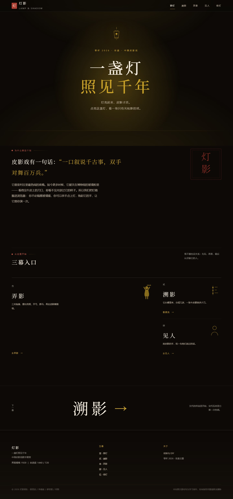 | 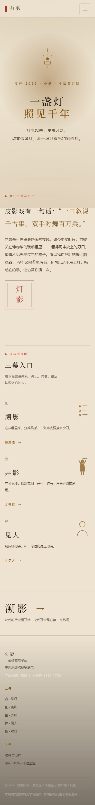 |
| 贰 · 溯影 | 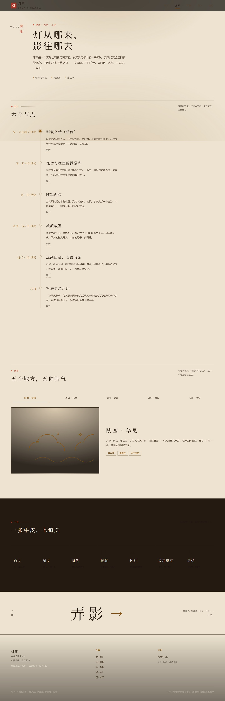 | 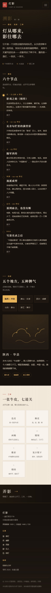 |
| 叁 · 弄影 | 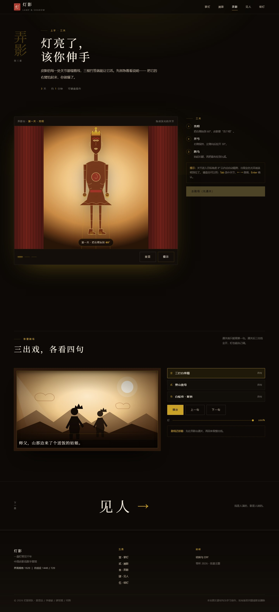 | 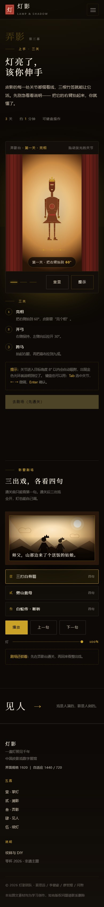 |
| 肆 · 见人 | 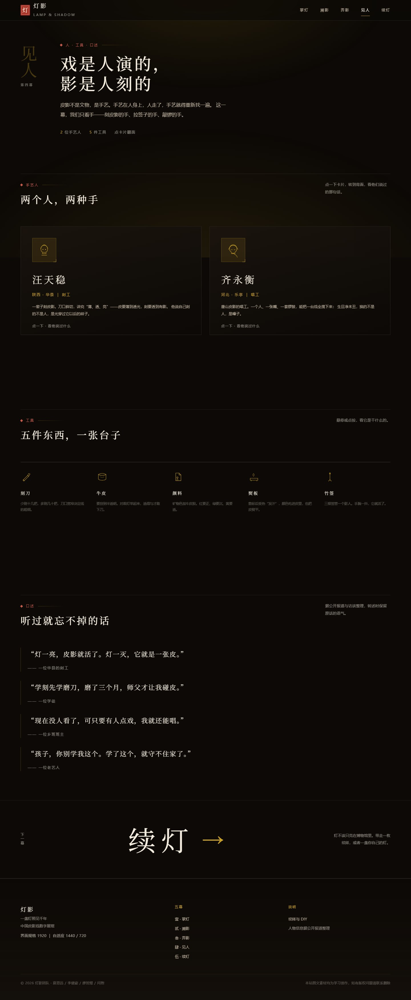 | 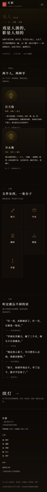 |
| 伍 · 续灯 | 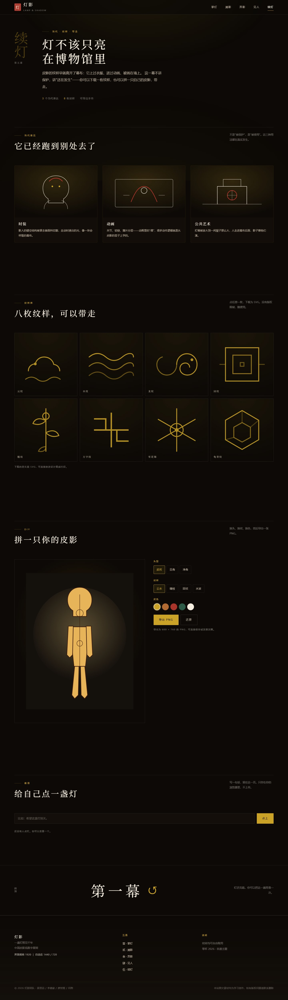 | 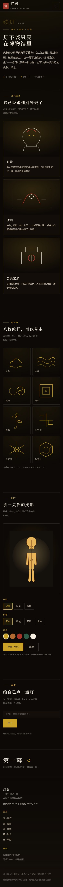 |

## 九、打包与提交

### 9.1 生成两个交付版本

仓库内置打包脚本，生成"单文件版"（每个 HTML 自包含，双击即开）与"工程版"（可读源码 + 本 README），并做外链、第三方库、死链扫描。

```powershell
# Windows PowerShell
powershell -NoProfile -ExecutionPolicy Bypass -File tools\pack-release.ps1 -Source web -Out dist

# PowerShell 7
pwsh -NoProfile -File tools\pack-release.ps1 -Source web -Out dist
```

### 9.2 生成匿名版

```bash
node tools/anonymize.mjs web dist/匿名版
```

脚本会替换页脚署名、写入中性的《作品说明.md》，并扫描姓名、学院等个人信息；**一旦命中即以退出码 1 拒绝打包**。

### 9.3 按手册命名提交

| 压缩包 | 对应目录 | 命名 |
| --- | --- | --- |
| 总包 | `dist/` | `零杯壹组-灯下黑-闫煦.zip` |
| 完整版本 | `dist/灯影_工程版` | `2026-零杯壹组-灯下黑-闫煦-完整版本.zip` |
| 匿名版本 | `dist/匿名版` | `2026-零杯壹组-灯下黑-闫煦-匿名版本.zip` |

两个子压缩包放进总包，总包内**带一层同名根目录**。命名错误可能直接被判无效，详见 [`资料/04_提交规范与验收清单.md`](资料/04_提交规范与验收清单.md)。

## 十、团队与分工

| 成员 | 角色 | 负责 |
| --- | --- | --- |
| 闫煦 | **队长** / 开发（成员 D） | 原生代码落地、响应式适配、Chrome 129 兼容、合规验收、双版本打包与邮件提交 |
| 夏思远 | 产品策划（成员 A） | 选题与方向、5 页架构与交互主线、需求一页纸、README 初稿 |
| 李健豪 | 视觉设计（成员 B） | Figma 原型、全站视觉规范、组件与微交互、素材交付 |
| 廖哲煜 | 内容主笔（成员 C） | 图文采写、事实核查、素材轻量化、路演 PPT |

> **协作方式**：每完成一轮改动即提交并推送，不攒批量。克隆仓库后执行 `sh tools/install-hooks.sh`，之后每次 `commit` 会自动推送到 origin（失败只写日志，不阻塞提交）。

## 十一、素材与版权

- 全站图形（皮影、纹样、地图、图标）均为本项目手绘 SVG 或 CSS 绘制，未使用任何第三方图片、字体文件或图标库。
- 文字内容参考公开的非遗资料与博物馆展陈说明，用于学习与展示；史实均按可核查来源撰写。
- 本项目仅用于「零杯」网页设计大赛评选与展示，不作商业用途。如涉及版权问题，请联系我们删除。

## 十二、更新日志

| 日期 | 内容 |
| --- | --- |
| 2026-10-19 | 完成选题、架构、需求一页纸与打包脚本 |
| 2026-10-19 | 五页开发完成：点灯开场、弄影台三关、影窗剧场、传承人、纹样库与 DIY |
| 2026-10-19 | 联调通过：五页控制台零报错、五档视口无溢出、键盘可通关、剧场可解锁 |
| 2026-10-20 | 合规整改：界面规格声明（页脚 + 本文件）、data-URI favicon、匿名版脱敏脚本、30 组合规审计；Chrome 129.0.6668.100 实测通过 |
| 2026-10-20 | 队名定为「灯下黑」，组别壹组，队长闫煦；README、提交规范与分工文档同步 |
| 2026-10-20 | M1：抽出 `tokens.css` 设计变量层、清空全部 16 处内联样式；重绘皮影本体（冠 / 靠子 / 护心镜 / 甲片 / 靴 + 眼口镂空），加三根操纵签并随手联动 |
| 2026-10-20 | M1+：全站视觉重构 v2「宋刻暗金」——更深的墨与更哑的旧金、字阶与间距重排、入口/流派/印章去色块改细线、按钮与标签去圆角 |
| 2026-10-20 | M1++：组件层重构——七道工序改刻本式表格、工具墙改实物陈列排（说明常显）、传承人卡改档案照式证件框 |
| 2026-10-20 | M1+++：影窗加木框与金线、剧场场景重绘（月/云/三层山/栏杆/双影人，三出戏各有晕色与点缀）、纹样卡加暖底与宋体名 |

---

<p align="center"><sub>一盏灯，一张皮，一双手。<br>灯亮起来，皮影才活。</sub></p>
